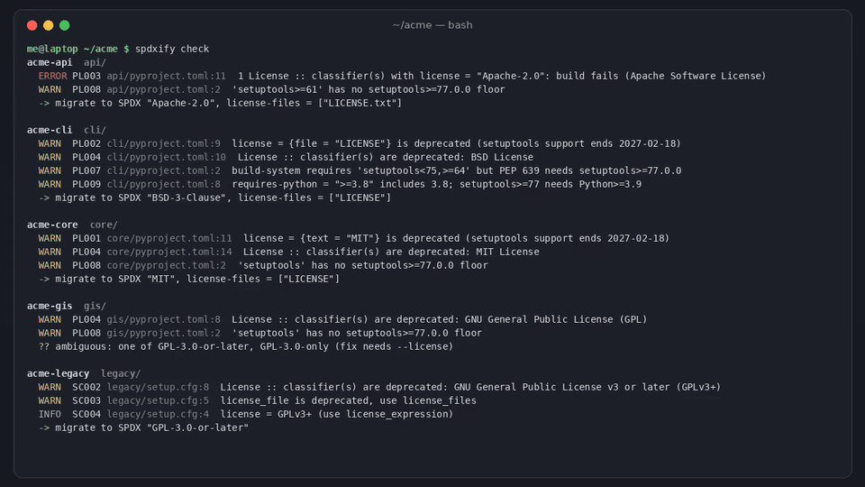

# spdxify

[](https://github.com/hamarshehmhmd/spdxify/actions/workflows/ci.yml)
[](LICENSE)


**Move your Python packages to PEP 639 license metadata before setuptools stops accepting the old forms (2027-02-18).**
`spdxify` finds `license = {text = ...}` / `{file = ...}` tables, `License ::` classifiers, free-text licenses that
aren't SPDX, `license-files` globs that match nothing and build backends too old for PEP 639, across a whole repo or
monorepo. It works out the right SPDX expression from your metadata **and your LICENSE file**, writes a
format-preserving patch, and checks the result with the real setuptools.



```bash
pipx install git+https://github.com/hamarshehmhmd/spdxify
```

## Why

Every `python -m build` of a project that still uses the old license fields prints this:

```
SetuptoolsDeprecationWarning: `project.license` as a TOML table is deprecated
    Please use a simple string containing a SPDX expression for `project.license`. ...
    By 2027-Feb-18, you need to update your project and remove deprecated calls
    or your builds will no longer be supported.
SetuptoolsDeprecationWarning: License classifiers are deprecated.
```

(The deadline was 2026-Feb-18 and was pushed back a year,
[pypa/setuptools@e034575](https://github.com/pypa/setuptools/commit/e03457577d7200d10fb6ac35fa37072c3cfe3a42), noted in [python/mypy#19389](https://github.com/python/mypy/issues/19389).) The migration looks
trivial but has traps that people keep hitting:

- **Half-migrating breaks the build today.** Switch to `license = "MIT"` but keep the `License :: OSI Approved :: MIT License`
  classifier and setuptools>=77 fails with `InvalidConfigError: License classifiers have been superseded by license
  expressions`. PEP 639 requires backends to reject that combination.
- **Free text isn't SPDX.** `license = "MIT License"` or `"Apache 2.0"` is a configuration error, not a warning.
- **Old backends can't read the new form.** `setuptools<77`, `hatchling<1.27`, `flit_core<3.12`, `pdm-backend<2.4`.
  Pins like `setuptools>=64,<75` turn the migration into a build failure.
- **Python 3.8:** setuptools 77+ needs Python 3.9, so projects still building on 3.8 can't just switch
  ([pypa/setuptools#4903](https://github.com/pypa/setuptools/issues/4903)).
- **Which license is it, exactly?** `License :: OSI Approved :: BSD License` doesn't say 2- or 3-clause; a GPL
  classifier doesn't say `-only` or `-or-later`; and sometimes the metadata says MIT while LICENSE is BSD.

There are open issues about this in hundreds of repos (search GitHub for
[`"project.license" as a TOML table is deprecated`](https://github.com/search?q=%22project.license%22+%22TOML+table+is+deprecated%22&type=issues)),
e.g. [matrix-nio#553](https://github.com/matrix-nio/matrix-nio/issues/553),
[scapy#4849](https://github.com/secdev/scapy/issues/4849),
[astronomer/starship#207](https://github.com/astronomer/starship/issues/207),
[cffconvert#419](https://github.com/citation-file-format/cffconvert/issues/419),
[equinor/fmu-tools#498](https://github.com/equinor/fmu-tools/issues/498).

## Usage

```console
$ spdxify check                 # scan the repo (recurses; skips .venv, node_modules, build, ...)
acme-api  api/
  ERROR PL003 api/pyproject.toml:11  1 License :: classifier(s) with license = "Apache-2.0": build fails (Apache Software License)
  WARN  PL008 api/pyproject.toml:2  'setuptools>=61' has no setuptools>=77.0.0 floor
  -> migrate to SPDX "Apache-2.0", license-files = ["LICENSE.txt"]

acme-cli  cli/
  WARN  PL002 cli/pyproject.toml:9  license = {file = "LICENSE"} is deprecated (setuptools support ends 2027-02-18)
  WARN  PL004 cli/pyproject.toml:10  License :: classifier(s) are deprecated: BSD License
  WARN  PL007 cli/pyproject.toml:2  build-system requires 'setuptools<75,>=64' but PEP 639 needs setuptools>=77.0.0
  WARN  PL009 cli/pyproject.toml:8  requires-python = ">=3.8" includes 3.8; setuptools>=77 needs Python>=3.9
  -> migrate to SPDX "BSD-3-Clause", license-files = ["LICENSE"]
...
$ spdxify fix                   # unified diff, nothing written
$ spdxify fix --write           # apply it (comments and formatting kept)
$ spdxify fix gis --license GPL-3.0-or-later --write    # when it can't tell, it asks instead of guessing
$ spdxify verify                # build metadata with the installed setuptools: warnings, errors, License-Expression
```

What `fix` changes, for example:

```diff
 [build-system]
-requires = ["setuptools"]
+requires = ["setuptools>=77"]
@@
 # license kept as a table since 2021
-license = { text = "MIT" }
+license = "MIT"
+license-files = ["LICENSE"]
 classifiers = [
     "Programming Language :: Python :: 3",
-    "License :: OSI Approved :: MIT License",
     "Operating System :: OS Independent",
 ]
```

`setup.cfg` gets `license_expression = ...`, `license_file` becomes `license_files` and `License ::` classifiers go.
`setup.py` is reported but not rewritten.

### How it picks the license

It reads every source it has: the string or table, the classifiers, and the text of `LICENSE`/`COPYING` (MIT, MIT-0,
BSD-2/3/4, 0BSD, ISC, Apache-2.0, MPL-2.0, (L/A)GPL, EPL-2.0, EUPL-1.2, BSL-1.0, Unlicense, CC0, PSF-2.0, Zlib). One
source narrows another (a `BSD License` classifier plus a 3-clause LICENSE file becomes `BSD-3-Clause`). If the sources
disagree, or nothing settles `-only` vs `-or-later` or `AND` vs `OR`, it stops and asks for `--license`. Every result
is validated with `packaging.licenses`, the same parser setuptools uses.

### Rules

`spdxify explain` lists them and `spdxify explain PL003` explains one.

| Rule | Severity | What |
|---|---|---|
| PL001 / PL002 | warn | `license = {text = ...}` / `{file = ...}` table (deprecated, removed 2027-02-18) |
| PL003 | error | `License ::` classifiers next to an SPDX `license` (build fails now) |
| PL004 | warn | `License ::` classifiers (deprecated) |
| PL005 | error | `license` string isn't a valid SPDX expression |
| PL006 | info | deprecated or non-canonical SPDX id (`GPL-3.0` → `GPL-3.0-only`) |
| PL007 / PL008 | error/warn | build backend pinned below PEP 639 support / no floor |
| PL009 | warn | `requires-python` includes 3.8 with setuptools (manual) |
| PL010 / PL011 | warn/error | `license-files` glob matches nothing / is invalid |
| PL012 | error | `license = {file = ...}` points at a missing file |
| PL013 | warn | metadata and LICENSE file disagree |
| PL014 | info | no license metadata but a LICENSE file exists |
| SC001–SC004 | | the same for `setup.cfg` |
| SP001 | info | legacy license lines in `setup.py` (manual) |

Options: `--format text|json|github`, `--fail-on info|warn|error|never` (default `warn`), `--min-severity`,
`--ignore PL008,PL009`, `--no-build-system` (fix without raising the backend floor). Pass a `pyproject.toml` path
instead of a directory to check one project without recursing.

### CI and pre-commit

```yaml
# .github/workflows/license-metadata.yml
- uses: actions/checkout@v5
- uses: hamarshehmhmd/spdxify@v0.1.0
  with:
    fail-on: warn
```

```yaml
# .pre-commit-config.yaml
- repo: https://github.com/hamarshehmhmd/spdxify
  rev: v0.1.0
  hooks:
    - id: spdxify
```

## Demo

The GIF above is cut from [`demo.mp4`](https://github.com/hamarshehmhmd/spdxify/releases/tag/v0.1.0) (narrated, about
2.5 minutes). It runs on [`examples/monorepo`](examples/monorepo): six packages with the usual mistakes, checked,
fixed and verified with setuptools 84. CI does the same thing and then builds every package in an isolated
environment with the latest setuptools and hatchling, failing on any license deprecation warning.

## Limits

- `verify` drives setuptools only. For hatchling, flit or pdm, run `python -m build` (CI does this for the hatchling example).
- Poetry 1.x `[tool.poetry] license` is out of scope (Poetry 2 projects with `[project]` are checked).
- It decides license identity from metadata and well-known license texts. It doesn't do legal review.

## Development

```bash
python -m venv .venv && .venv/bin/pip install -e ".[test]" hatchling && .venv/bin/pytest -q
```

## License

GNU Affero General Public License v3.0 or later (`AGPL-3.0-or-later`), see [LICENSE](LICENSE).
Commercial licenses without the AGPL obligations are available from the author, Mohammad Hamarsheh
(open an issue or contact [@hamarshehmhmd](https://github.com/hamarshehmhmd)).
